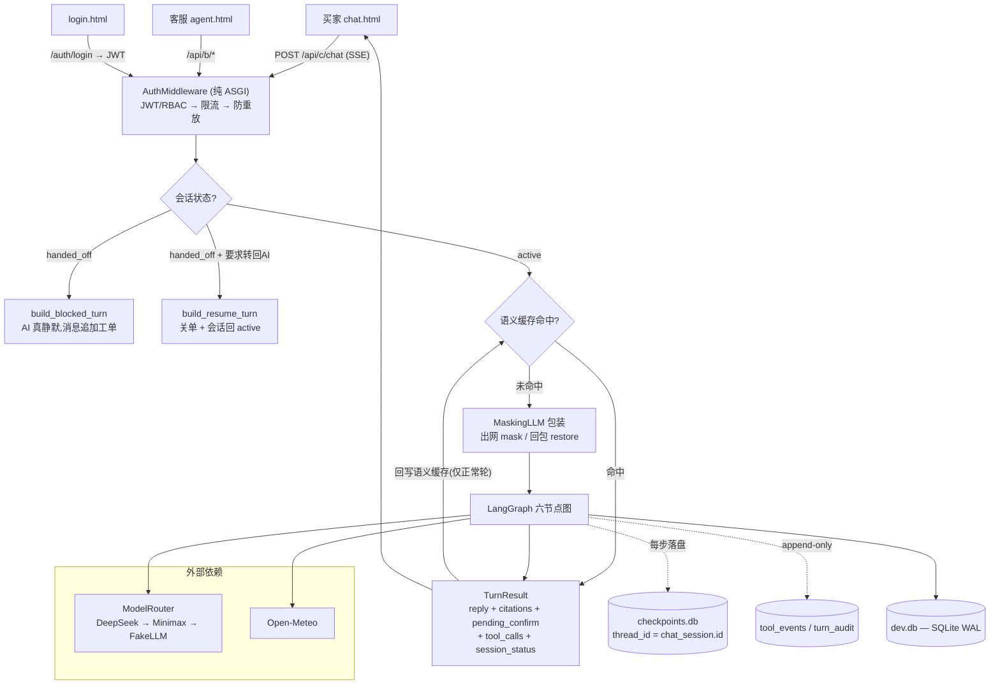
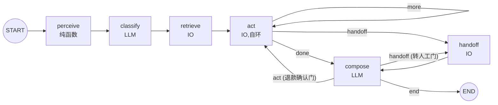

# 售后 Copilot — 项目总览(Onboarding)

> 生成:2026-11-16,由新会话实地核查代码 + 复算评测报告后写成。
> **本文不是产品事实源**。产品口径以 [`PRD_v1.md`](PRD_v1.md) 为准,交付现状以 [`交接_20261112.md`](交接_20261112.md) 为准。
> 本文的作用是:让新人在 15 分钟内知道「这是什么、怎么长的、每层用什么、现在可信到什么程度」,
> 并把**文档与代码已经对不上的地方**一次性列清(见 §6),避免照着过期文档下判断。
>
> 所有数字均为本次实测/复算,命令与来源逐条标注。凡未验证的一律进 §7 清单,不写成结论。

---

## 1. 这个项目解决什么问题

**一句话**:给单店电商做的售后客服 Copilot——买家一个聊天入口,客服一个工单工作台,
把「政策问答 / 订单判责 / 转人工」三类售后咨询跑成一条**有回执、可复跑、写操作必须人工确认**的端到端链路。

| 维度 | 内容 |
|---|---|
| 目标用户 | 每天 50–200 条售后咨询的淘宝/独立站小店,1–2 名客服([PRD §1](PRD_v1.md)) |
| 核心场景 | 政策问答(带条款号引用)/ 订单判责(符合则建退款申请单)/ 转人工(建工单 + AI 停答) |
| 核心价值 | 不是「能聊」,而是**写操作可控**:永不自动打款,退款只创建申请单;每个写操作有业务单号 + 状态 + UTC 时间 + trace_id,且 `verified` 靠回读 DB 而非模型自述 |

### 关键差异化(这是本项目真正的看点)

1. **确定性护栏优先于模型聪明**。[`guardrails.py`](../backend/app/guardrails.py) 1155 行纯函数、无 IO、无随机,
   给每一类已知失败模式加一层非 LLM 兜底:注入检测、反编造(状态声称无证据就逐句换成诚实话术)、
   引用保真(关键数字短语没逐字出现就确定性追加条款原文)、承诺性话术禁词、PII 出网脱敏。
   设计铁律写在文件第 3 行:「不指望模型变聪明」。
2. **写操作先确认后执行,且恢复不重放**。确认卡建在**上一个 super-step**,`interrupt` 在节点入口,
   恢复时节点从头重跑也只读状态、不产生副作用([`runner.py:14-27`](../backend/app/graph/runner.py:14),
   引了 LangGraph 源码语义)。
3. **评测口径经过用户裁决,不是自说自话**。真实模型采样非确定性与「硬断言 100%」存在原理性张力,
   项目把它升级成 PRD 决策 D-11(critical 类 100% + 整体 ≥0.9 + agreement ≥0.8 + critical=0),
   而不是偷偷放宽断言。

### 明确的非目标([PRD §3](PRD_v1.md),每项都标了扩展点)

多租户 SaaS / 计费、自动退款·发券·改价、售前营销·生图·文案、完整 i18n·多币种、
分布式·消息队列·微服务、自研编排框架、可视化评测大盘。
其中「自动退款」**不留扩展点**——退款永远只是「创建申请单 + 人工审核」。

---

## 2. 技术路线

### 2.1 分层选型(版本取自 [`requirements.lock.txt`](../requirements.lock.txt),唯一依赖事实源)

| 层 | 选型 | 版本 | 选型理由(PRD 决策号) |
|---|---|---|---|
| 运行时 | Python | 3.13.15,项目根 `.venv` 锁死 | D-03:本机 3.13/3.14 双版本共存,禁止全局装包 |
| Web | FastAPI + Starlette + uvicorn | 0.162.0 / 1.10.0 / 0.54.0 | 无 key 也能起服务,`/health` 200 |
| ORM/迁移 | SQLAlchemy + Alembic | 2.1.8 / 1.20.1 | 守卫式更新 + CHECK + 迁移三件套 |
| 库 | SQLite(WAL) | 内置 | D-01:单机是**显式选择**,不是妥协;PG 只留方言扩展点 |
| 编排 | LangGraph + checkpoint-sqlite | 1.2.20 / 3.1.3 | D-01:一张六节点图,不自研编排 |
| 校验 | Pydantic v2 | 2.14.3 | 感知层归一化 + 工具 schema 层校验 |
| 稀疏检索 | rank-bm25(BM25Plus) | 0.2.2 | D-02 原始方案 |
| 稠密检索 | scikit-learn(TF-IDF + TruncatedSVD) | 1.9.1 | W9 追加,**是 LSA 不是神经 embedding**,见 §6-F6 |
| 数值 | numpy / scipy | 2.5.4 / 1.18.1 | 向量与余弦 |
| LLM | httpx 直连 OpenAI 兼容端点 | 0.28.1 | D-08:锁定 `deepseek-flash`;备胎 Minimax |
| 前端 | 原生 HTML/CSS/JS | 无 | 零 CDN、零构建、零第三方依赖 |
| 测试 | pytest | 9.2.0 | 密封 FakeLLM,无 key 全绿 |
| 部署 | Docker 多阶段 + nginx + 可选 PG/Redis/Prometheus/Grafana | — | **运行时未验证**,见 §7 |

### 2.2 LLM 接入方式(三档 + 熔断)

```
build_llm()  ── 无 LLM_API_KEY ──→ FakeLLM(规则引擎,测试密封)
             └─ 有 key ─┬─ 未配 LLM_FALLBACK_* ──→ RealLLMClient(裸)
                        └─ 配了 ──→ ModelRouter(primary=DeepSeek, fallback=Minimax, degraded=FakeLLM)
```

- 只读 `os.environ`,**不解析 `.env`**([`llm/__init__.py:5-7`](../backend/app/llm/__init__.py:5))——
  防止有 `.env` 的机器上跑测试误触真实 API 烧钱。加载 `.env` 是启动器/脚本的显式行为。
- 熔断只认 5xx / 429 / 超时 / 无状态码网络错;**401/402/403 一律直接上抛不降级**
  ([`router.py:48-62`](../backend/app/llm/router.py:48))——鉴权和余额问题重试救不了,悄悄降级只会藏故障。
- 流式降级有边界:**还没吐出任何增量**才允许换档从头重来;已吐增量则直接抛错,避免重复内容
  ([`router.py:242-264`](../backend/app/llm/router.py:242))。
- ⚠️ 熔断器的**跨请求**状态目前是失效的,见 §6-F4。

### 2.3 第三方服务

| 服务 | 用途 | 接入 | 边界 |
|---|---|---|---|
| DeepSeek `deepseek-flash` | 主用模型 + LLM 裁判 | httpx,`.env` 的 `LLM_API_KEY` | 真实调用只在评测/显式注入时发生 |
| Minimax | 热备模型 | `LLM_FALLBACK_*` 环境变量 | 默认 MOCK 声明,只有 `healthcheck()` 允许出网 1 次 |
| Open-Meteo | 天气辅助信息(W16) | 免 key,5s 超时,TTL 10min | 测试全 mock 零外呼;定位为「暴雨延误」类售后附注,不做通用天气助手 |

---

## 3. 架构流程图

### 3.1 请求主链路



### 3.2 六节点图拓扑(与 [`build.py:96-111`](../backend/app/graph/build.py:96) 逐边一致)



**两个关键边界条件**:

- 自环上限由 `state["steps"]` 自己守(`NODE_STEP_LIMIT = 8`,第 9 圈不再调工具→强制 handoff),
  **不依赖 LangGraph 的 `recursion_limit`**——后者超限是抛异常,不是优雅降级
  ([`state.py:44`](../backend/app/graph/state.py:44),[`build.py:53-55`](../backend/app/graph/build.py:53))。
- `initial_state()` **每个字段都显式写全**。同一 `thread_id` 多轮复用,LangGraph 会把新输入
  **合并**到已有 channel 上;不写全则上一轮的 `steps/observations/confirm` 会漏进本轮
  ([`state.py:66-89`](../backend/app/graph/state.py:66))。

### 3.3 写操作确认门时序(先确认后执行,恢复不重放)

```
第 N 圈 act:  调用写工具 → registry 只建确认卡 + 落 confirm_request → 返回 pending_confirm
              (此时零业务副作用;HTTP 响应带确认卡四要素 + confirm_token)
第 N+1 圈:    节点入口发现 confirm 存在且 decided=False → interrupt() 挂起,全状态落 checkpoint
────── 人工决定(可以跨进程重启)──────
resume:       节点从头重跑 → 只读 state["confirm"](无副作用)→ 拿到决定 → 才真正 execute
幂等保证:     ConfirmRequest.status 一旦 confirmed,_execute_confirmed 直接返回 CONFIRM_NOT_PENDING
```

---

## 4. 逐模块技术栈与实现思路

> 规模实测:`backend/app` **84 个 py / 22,241 行**;`backend/tests` **47 个测试文件 / 17,893 行**;
> 迁移 **10 个**(0001→0010);ORM 实际建表 **25 张**;注册工具 **6 个**;git **99 次提交**,工作区干净。
>
> 复算命令:
> ```bash
> find backend/app -name '*.py' | wc -l          # 84
> find backend/app -name '*.py' -exec cat {} + | wc -l   # 22241
> git log --oneline | wc -l                      # 99
> ```
> 表数与工具九字段用 ORM/注册表内省得到(不是数文件):
> ```bash
> cd backend && ../.venv/Scripts/python.exe -c "import app.models as m; print(len(m.Base.metadata.tables))"
> ```

### 4.1 感知层 `perception.py`(155 行)

- **技术栈**:Pydantic v2 `BaseModel`(`extra="forbid", frozen=True`)。
- **职责**:外部进线 → 不可变 `Percept`。**纯函数,无 IO**——不落库、不写 trace、不调工具/LLM。
- **实现要点**:去零宽字符(8 种)→ 空文本显式拒绝 → 超 4000 字截断并标 `truncated`/`original_length`
  (**不静默丢数据**)→ 附件只收 http(s) URL,**拒收 base64/data URI** → 在清洗后文本上算护栏 `flags`。
- **关键接口**:`normalize(text, attachments, locale, channel) -> Percept`;失败抛 `PerceptionError`(路由层 400)。
- **依赖**:`guardrails`(单向,`guardrails` 不反向 import 任何业务模块,避免循环依赖)。

### 4.2 护栏层 `guardrails.py`(1155 行)

- **技术栈**:纯 `re` + 常量表,零依赖、零 IO、零随机 → 全部可单测。
- **职责**:所有确定性安全/保真规则的**单一可审计入口**。
- **实现要点**(按 FIX 编号):

| 组 | 机制 | 关键函数 |
|---|---|---|
| FIX-1 | 订单核验强制链(已调过永不重复注入) | `needs_order_verification` |
| FIX-3 | 注入检测分**硬/软**两档:SQL/命令/伪造工具调用=硬拦截;自然语言越权=**剥离命中片段后继续处理正当诉求** | `detect_injection` / `strip_injection` |
| W6-A5 | prompt 探测(套提示词/上下文擦除/越狱/索要凭据)= **图前硬拦截**,零工具零业务事件 | `detect_prompt_probe` |
| FIX-4 | 反编造:状态声称按句匹配 → 无对应证据键就换成诚实话术,同类连续句只替一次 | `audit_status_claims` |
| FIX-5 | 引用保真:条款里「数字+单位」短语未逐字出现 → 确定性追加原文,**不回炉模型** | `ensure_citation_fidelity` |
| FIX-6 | handoff 原因归一化成 7 值枚举(顺序即优先级,投诉优先于金额争议) | `map_handoff_reason` |
| FIX-9 | 偏好逐字引用 + **回声守卫**(新记录偏好的那一轮记忆还没注入,所以单独保证回声) | `ensure_recorded_preference_echo` |
| W7-1 | PII 正则 ID→手机号→地址**顺序应用**,数字边界防把身份证中段误判成手机号 | `PII_PATTERNS` |
| W7-4 | 坐席建议回复的承诺性话术(到账时间/赔偿金额/保证类)**命中即删整句**,不整段重写 | `strip_commitment_sentences` |
| W13 | 对客脱敏:内部条款代号 `RP-xx/LP-xx` → 客户可读标题,兜底「相关规定」保证不残留 | `sanitize_customer_text` |
| W16 | 天气白名单**两档**:强档=明确天气问句;弱档=天气词 **必须叠加物流语境**。越界主题判定优先 | `is_in_scope_weather_query` / `is_out_of_scope` |

- **设计亮点**:软注入不一刀切。`strip_injection` 剥离攻击片段后**仍服务正当诉求**,
  这条语义有专门的回归测试保护(`test_graph.py::test_fix3_*`),所以 W6 新增 prompt 硬拦截时
  刻意**不**把中文「忽略以上指令+正当诉求」升级为硬拦截([`guardrails.py:256-258`](../backend/app/guardrails.py:256))。

### 4.3 编排层 `graph/`(build 112 / state 90 / nodes 1549 / runner 526 行)

- **技术栈**:LangGraph `StateGraph` + `SqliteSaver`,`GraphState` 是 `TypedDict(total=False)`。
- **职责**:六节点装配 + 条件边 + 确认门 + 对外 `run/resume/handle_turn`。
- **实现要点**:
  - State **只放可 JSON 序列化值**:不放 ORM 对象、不放 Session/LLM 句柄、工具结果只留摘要
    ([`state.py:1-8`](../backend/app/graph/state.py:1))。
  - checkpointer 用**独立文件** `data/checkpoints.db`,与业务库 `dev.db` 分离——图状态是运行期断点,不是业务数据。
  - 每次调用**重新编译图**:节点闭包绑定本轮 Session([`build.py:85`](../backend/app/graph/build.py:85))。
  - 挂起判定必须 `snapshot.next` **且** `snapshot.interrupts` 双条件——只有 `next` 说明还在队列里
    ([`runner.py:169-172`](../backend/app/graph/runner.py:169))。
  - `nodes.py` 是最大单文件,`make_nodes()` 内闭包出 6 个节点 + `_after_tool` / `_execute_confirmed` / `_reply_for` 等。
- **对外接口**:`run()` / `resume()` / `handle_turn()` / `build_blocked_turn()` / `build_resume_turn()` / `pending_handoff_confirm()`。
- **依赖**:`perception`、`tools.registry`、`retrieval`、`memory`、`llm`、`services.tickets`、`trace`。

### 4.4 工具层 `tools/`(registry 319 行 + 6 个工具)

- **技术栈**:`dataclass(frozen=True)` 九字段契约 + Pydantic `TypeAdapter`。
- **九字段实测**(内省 `registry.list_specs()`):

| name | side_effect | requires_confirm | timeout_s | idempotency_key |
|---|---|---|---|---|
| `shop__get_order` | read | False | 5.0 | — |
| `policy__search` | read | False | 5.0 | — |
| `policy__check_return` | read | False | 5.0 | — |
| `weather__query` | read | False | 5.0 | — |
| `refund__create` | **write** | **True** | 10.0 | `order_id, reason, amount_cents, items` |
| `handoff__create_ticket` | **write** | **True** | 10.0 | — |

- **三层校验分工**:registry 只做 schema(失败 `SCHEMA_ERROR` 不重试)→ handler 做 resolve(存在性/归属)
  + 业务规则 → 写工具的 `invoke` **不落业务数据**,只建卡 + 落 `confirm_request`。
- **失败四分类**:`SCHEMA_ERROR` / `NOT_FOUND_OR_FORBIDDEN` / `BUSINESS_REJECT` / `UNKNOWN_OUTCOME`(超时,
  `retryable=false`,先查幂等台账)/ `TRANSIENT`(≤2 退避)。
- **两个踩坑修复值得读**:
  - `_write_event` 写完**立刻 flush**——`_next_step` 用 `max(step)+1` 取号,上一条未 flush 会让同事务内两次调用撞号(ISS-63)。
  - `ainvoke` 的 worker 线程**自建独立 Session**——`Session` 非线程安全,直接丢进 `to_thread` 会交叉事务(ISS-62)。
- **越权口径**:不存在与越权**统一**返回 `NOT_FOUND_OR_FORBIDDEN`,不泄露「订单存在但不属于你」。

### 4.5 检索层 `retrieval/`(hybrid 450 行 + bm25/vector/chunker)

- **技术栈**:rank-bm25 `BM25Plus` + sklearn `TfidfVectorizer`/`TruncatedSVD` + numpy。
- **实现思路**:双路各取 top-20 → **加权 RRF**(k=60)→ 覆盖率乘子 → 阈值判 `no_hit` → Jaccard 重排取 top-5。
- **融合分公式**(常量全部可复算,[`hybrid.py:14-22`](../backend/app/retrieval/hybrid.py:14)):

```
rrf(d)    = Σ_r  s_r(d) / (60 + rank_r(d))
s_bm25(d) = min(1, bm25_raw(d) / 40.0)
s_vec(d)  = max(0, cosine(d))
cover(d)  = |Q ∩ D| / |Q|                    # 长度≥2 的 token 集合
fused(d)  = rrf(d) × (0.2 + 0.8 × cover(d))
rerank(d) = fused(d) + 0.15 × jaccard(d) + clause_id_prior(0.05)
no_hit    ⇔ max(fused) < 0.005
```

- **为什么不是纯 RRF**:18 条小语料上纯 `1/(k+rank)` 无法区分「排名第 1 但只有 4.4 分」与「排名第 1 且 47 分」。
- **覆盖率是相关性闸**:未覆盖问句(如「会员积分怎么兑换」)在向量路能拿到 0.7868 的高余弦,
  但关键词交集为空 → `cover=0` → 融合分只剩两成 → 被阈值挡下。**这是防幻觉检索的关键设计**。
- **阈值定标**:0.005 = `sqrt(0.008135 × 0.003072)`(覆盖句最低 × 未覆盖句最高的几何平均),
  两侧余量 39% / 63%,10 句定标表在 `tests/test_hybrid.py::CALIBRATION_CASES`。
- **缓存与热更新**:按 `(id, version, updated_at)` 签名缓存,数据变化自动失效;
  `POST /api/kb/reload` 显式重建并落 `kb_vector` 表;**KB 变则语义缓存一并失效**
  ([`hybrid.py:418-432`](../backend/app/retrieval/hybrid.py:418),延迟 import 破循环依赖)。
- 检索只取 `status=active` 条款:draft 不生效、retired 不可见。

### 4.6 记忆层 `memory/`(store 414 / whitelist / injection / decay / models)

- **技术栈**:SQLAlchemy `memory` 表 + 白名单常量表。
- **三处放**([PRD §5](PRD_v1.md)):店铺规则→知识库(版本化带 clause_id)/ 订单事实→DB(唯一事实源)/
  买家偏好→长期记忆(白名单 + source/TTL/scope)。
- **实现要点**:4 类型(`fact/episode/preference/procedure`)× 3 来源(`user_stated/order_derived/agent_inferred`)
  的 `WRITABLE` 矩阵;`DEFAULT_TTL_DAYS` + `MIN_DECAY_SCORE=0.3` 衰减;
  **定价指令隔离**(`is_pricing_instruction` / `is_injection_instruction`)——「以后打 8 折」不入可执行记忆。
- **三时机**:任务开始注入一次并声明「可能过时」,任务结束才抽取。

### 4.7 模型网关 `llm/`(router 396 / real_client / minimax_client / base)

见 §2.2。补充:`CircuitBreaker` 三态机 `closed →(连续3次熔断失败)→ open →(30s)→ half-open(1探针)→ closed`,
每次转移进 `transitions` 流水并写 `router_failover` trace 事件;写盘失败不影响主流程。

### 4.8 履约纵深 `services/refunds.py`(442 行)+ `api/fulfillment.py` + `sla.py`

- **金额只在服务端折算**,整数分可复算:传 `items` 则 `line_cents = qty × unit_cents` 并忽略 `amount_cents`;
  校验 ≤ 实付残额(实付 − 已退),同一子项累计退 qty ≤ 购买 qty(**含其他活跃退款单占用**)。
- **状态迁移一律守卫式**(`WHERE id + status`,rowcount=1),非法迁移 409。
- 仓库回调**不复用 JWT**,改 HMAC 签名 `hex(sha256(raw_body + FULFILLMENT_SECRET))` + nonce 去重(重放 409)。
- 全单退完(残额=0)才推 `order.refunded`,部分退保持 `delivered`。
- SLA:独立守护线程,queued 超 `SLA_QUEUED_MINUTES`(默认 30)未领 → `sla_breached=True` + 每单仅一次告警;领取清零。

### 4.9 接入安全 `security.py`(740 行)+ `main.py` 中间件

- JWT HS256 / 2h;**纯 ASGI 中间件**而非 `BaseHTTPMiddleware`——后者会影响 SSE 流式。
- RBAC:`/api/c/*` 只认 buyer,`/api/b/*` 只认 agent;身份**一律从 token 取**,请求体/query 的
  `customer_id` 在 enforce 模式下无身份效力。
- 限流:用户 5 QPS(突发 10)+ 租户 50 QPS + chat 日 20 万 token 配额;429 带 `Retry-After`。
- 防重放:5 个写接口必须带 `X-Timestamp` + `X-Nonce`,±5min 窗口,同 `(subject, nonce)` 二次 → 409。
- WS 双通道 + **归属校验**:买家只能连自己的会话(ISS-48 修的是「带合法 buyer token 就能窃听任意 session」),
  关闭码 4400/4401/4403。
- CORS 白名单来自 env,**任何 `*` 都会被剔除**;必须最后 `add_middleware`(Starlette 后加的是外层),
  让 401/429 也带 CORS 头。

### 4.10 可观测与飞轮 `observability.py`(560 行)+ `jobs.py`(542 行)+ `api/badcases.py`

- `/metrics` **零第三方依赖**手写 Prometheus 文本格式;三态门控:`METRICS_ENABLED=0` 关整个端点 /
  默认只允许本机 / `METRICS_ALLOW_REMOTE=1` 才允许外部抓取。后台 5s 刷新缓存,请求路径只读缓存。
- 异步队列:SQLite 单文件单 worker 线程,失败重试 3 次进 dead-letter;
  **`lifespan` 必须 `start_worker`**,否则队列退化为「调用方事务内同步执行」,P95 直接被业务写锁拖累。
- 坏例回流:`badcase` 表 → promote 到 `data/eval/drafts/` → **升版由主会话执行**(冻结区治理)。

### 4.11 评测层 `eval/`(engine 775 / hard_assert / judge / report / validate_cases)

- 三层判定:硬断言(`FAIL_HARD`/`FAIL_CRITICAL`,**不进加权**)→ LLM 裁判三维 rubric
  (accuracy/compliance/safety,低温强制 JSON,用户输入转义分隔防注入)→ 人工抽检 10%。
- `task_success` **由服务端硬断言重算**,不采信裁判。
- 报告 6 指标:`pass_rate`(带分母+n)/ `by_layer` / `critical_fail_count`(单列)/
  `judge_agreement` / `cost_per_case` / `p95_latency`(**用户实际等待,非裁判耗时**)。
- 烧钱纪律(D-09):批量评测中 5xx/401/402/403/429 **立即 `BatchAbort`**;单轮对话路径才有限重试。

### 4.12 前端 `frontend/`(8 文件,原生零构建)

| 文件 | 行数 | 职责 |
|---|---|---|
| `api.js` | 157 | **三页唯一持有底层网络调用的文件**(W15 U5 通信收拢)。统一信封 `{ok,status,data,error,resp}`;写方法自动注入防重放头;15s `AbortController` 超时;401 交页面回调;`raw` 模式交还原生 Response 给 SSE |
| `app.js` | 1368 | 买家页:SSE 增量、确认卡、stepper 双视图、价格药丸、四态角标、`view=brief` 最小字段轮询、`aux_degraded` 降级壳 |
| `agent.js` | 1684 | 客服工作台:队列(queued 优先→`last_msg_at` 倒序)、领单、回复(可内部备注)、关单、WS 实时刷新 |
| `ui.js` | 107 | 共享 UI 原子 |
| `chat.html` / `agent.html` / `login.html` | 96 / 193 / 237 | 三页壳,品牌「安心退」 |

品牌色 `#C05621`(favicon 内联 SVG 同色)。

### 4.13 部署 `deploy/` + CI

- `Dockerfile` 多阶段 / `docker-compose.yml` 6 服务(backend / nginx / postgres / redis / prometheus / grafana)+ 5 volume /
  `nginx.conf` / `prometheus.yml` / `entrypoint.sh` / `lint_artifacts.py`(交付物静态自检 6 组)。
- CI 4 门禁([`.github/workflows/ci.yml`](../.github/workflows/ci.yml)):`lint`(compileall + 交付物自检)/
  `pytest`(密封 FakeLLM,**先确认未注入真实凭据**)/ `eval --smoke`(报告写临时目录,不脏冻结区)/ `deploy` 规则。
- ⚠️ **`deploy/README.md` 首屏明确标注:本机无 Docker/PG/Redis,镜像构建与编排启动只经结构级静态校验。**

---

## 5. 现在可信到什么程度(实测数字 + 证据链)

### 5.1 真实模型评测 R3(本次从 JSON 复算,不采信文档转述)

报告:[`data/eval/reports/w4c-20261109T141553Z-5bbfcb.json`](../data/eval/reports/w4c-20261109T141553Z-5bbfcb.json)
`meta.mode=real`,`llm=judge=deepseek-flash`,48 条 × repeat 3。

| 指标 | 值 | 复算 |
|---|---|---|
| pass_rate | **0.9653** | 139/144 = 0.965277 ✓ |
| critical_fail_count | **0** | ✓ |
| judge_agreement | 0.9722 | 140/144 = 0.972222 ✓ |
| golden | 0.9123 | 52/57 ✓ |
| adversarial | 1.0 | 42/42 ✓ |
| edge | 1.0 | 30/30 ✓ |
| regression | 1.0 | 15/15 ✓ |
| 分层加总 | 139 | 52+42+30+15 = 139 ✓ 与总数一致 |
| p95 用户等待 | **8910 ms** | `scope=user_wait_only(对话轮+确认,不含裁判)` |
| 真实 token | 782,357 / 468 请求 | agent 229,831 + judge 552,526 |

**三个必须一起读的口径**:

1. **成本字段是 0,不是没花钱**。报告 `pricing.status="TBD"`(生成时官方价目还没到),
   token 用量是真实的。用[存档价目](../data/eval/pricing_deepseek_20261109.md)复算(reasoning 属 completion 子集不重复计):
   空闲 `653,420×1 + 128,937×4 = 1.1692 元`;高峰 `×2 / ×8 = 2.3383 元`。与交接的「第三轮预算 ≈2.5 元」吻合。
2. **裁判与被测模型同源**(`judge_same_source_risk: true`,报告 `meta.assumptions` 已如实披露)。
   所以 agreement 0.9722 **存在自偏好偏差**,不能当作独立第三方一致性读。
3. **golden 层最弱(0.9123),对抗/边界/回归全 100%**。这不是巧合:
   确定性护栏是針對 adversarial 失败模式逐条加的(W4-C-FIX),而 golden 依赖模型自由措辞,反而更容易漂。

### 5.2 系统性簇已闭环(容易误判的地方,特别澄清)

R3 的 `clusters` 里有一条 `fact_mismatch, count=3, systematic=true`(`CS-MEMORY-001` 三次全败)。
按 D-11「同类 ≥3 必须修复或用户显式豁免」,这看起来像个未闭合的阻塞项——**但它已经闭合了**:

| 时间 | 报告 | 内容 | 结果 |
|---|---|---|---|
| 11-09 | R3 全量 | `CS-MEMORY-001` 0/3 | `systematic=true` |
| 11-10 02:59 | `w4c-…146fef` | 单案真实复跑 | **仍 0/3**,首版修法无效 |
| 11-10 03:24 | **`w8fix-verify2`** | 单案真实复跑 | **3/3 通过,零失败零簇** |

修法留痕在 [`guardrails.py:688-708`](../backend/app/guardrails.py:688):原先 gate 要求 `intent_name` 命中白名单,
真实模型把尺码偏好轮漂移到 `policy_qa` 时 gate 关闭;改成 **scope + 文本双命中**,与 intent 标签解耦。
另加 `ensure_recorded_preference_echo` 回声守卫(记录偏好那一轮记忆尚未注入,拼接 gate 永不触发)。

👉 **只读 R3 的 JSON 会看到 `systematic=true` 而误判项目有未修缺陷。完整证据链是 R3 + `w8fix-verify2` 两份。**

### 5.3 测试

- **本次全量实测(2026-11-16)**:`1 failed, 759 passed, 7 warnings in 1472.80s (0:24:32)`,
  `--collect-only` 收集数 **760**,与交付声明一致。日志:`.tmp/overview_pytest.log`。
- 唯一失败 = `test_delivery.py::test_shell_scripts_syntax`,报错与交接 §5.1 一字不差:
  `H:\Git\usr\bin\bash.EXE: *** fatal error - NtCreateDirectoryObject(...): 0xC0000022`。
  **对照实验已做**:`bash -n serve.sh` → rc=0、`bash -n run_eval.sh` → rc=0,
  脚本本体语法无恙 → 确认是「python 子进程 spawn bash」的宿主环境问题,**非产品缺陷**。
- **修 F4 后全量复测(同日)**:`1 failed, 762 passed, 7 warnings in 1254.36s (0:20:54)`,
  收集数 **763**。日志:`.tmp/f4_final_pytest.log`。
  与修复前基线逐项对照:**通过 759 → 762(+3,即新增的 3 条)、收集 760 → 763、失败数恒为 1**
  (同一条环境性失效)→ **零回归**。
- 零成本预检:
  ```bash
  .venv/Scripts/python deploy/lint_artifacts.py             # 本次实测:6 组 OK,rc=0 ✓
  .venv/Scripts/python backend/scripts/check_w1_cases.py    # 期望 10/10(本次未跑,避免与全量测试争库)
  ```

---

## 6. 本次核查发现的漂移与缺口

> 全部是**本次实地核对代码后**得到的,不是从文档转述。按影响排序。
> 说明:这些不影响「项目可交付」的结论,但会**误导照文档下判断的人**,所以逐条列清。

### F1 — README §3 架构块整体过期(文档)✅ 2026-11-16 已修

[`backend/README.md:27-54`](../backend/README.md:27) 的文字架构图写着:

| README §3 声明 | 实测 |
|---|---|
| 「5 工具」 | **6 个**(W16 加了 `weather__query`) |
| 「17 张业务表」 | **25 张** |
| 「迁移 0001→0005」 | **0001→0010** |
| 「客服(待做 UI,本期无)」 | `frontend/agent.html` + 1684 行 `agent.js` **已交付** |

### F2 — README 同一文件内测试数自相矛盾(文档)✅ 2026-11-16 已修(§5 与 §12 统一为 763)

§5 快速开始写「全量测试(**453** 个用例)」,§6 脚本生成块写「**760** 个 pytest 用例」。
§6 有 `test_delivery.py::test_readme_numbers_match_script` 逐字比对保护,**§5 是手写残留、无测试覆盖**。

### F3 — README §7.4 MOCK 边界**低报**了已接线能力(文档)✅ 2026-11-16 已修

[`backend/README.md`](../backend/README.md) §7.4 末尾仍写:

> `build_llm()` 尚未接 `ModelRouter`……`SemanticCache` 也尚未接 `api/chat.py` 的 classify 前链路
> (全仓唯一调用点是 `retrieval/hybrid.py` 的 `clear()`),两处生产链路接线均列为后续候选

**两处 W13 都已接线**:
- [`llm/__init__.py:101`](../backend/app/llm/__init__.py:101) `return ModelRouter(primary, fallback)`
- [`api/chat.py:259`](../backend/app/api/chat.py:259) `semantic_cache.lookup(...)` 在 classify 前,命中直接构造 `TurnResult`

同类:§10 扩展点表仍把「向量检索」列为「已预留、待接」,而 W9 的 `HybridRetriever` 已是默认检索路径。

### F4 — 熔断器跨请求状态失效(**代码**,已于 2026-11-16 修复)

**事实链**:
- [`api/chat.py:282`](../backend/app/api/chat.py:282) `base_llm = build_llm()` 位于 `_run_turn()`(定义在 175 行)内,
  该函数每个请求调用一次(451 行同步入口 / 574 行作业 worker)。
- [`llm/__init__.py:97-101`](../backend/app/llm/__init__.py:97) 每次 `build_llm()` **新建** `RealLLMClient` 与 `ModelRouter`,
  `ModelRouter.__init__` 又新建两个 `CircuitBreaker`。
- 全仓**无 LLM 单例、无 `lru_cache`**(已 grep 确认)。

**后果**:每轮对话拿到的都是 `failure_count=0` 的全新熔断器。
- ✅ **同一请求内的主→备→规则降级照常工作**(`_chain()` 循环),这是主要保护,没坏。
- ❌ `open` 状态、30s 冷却、half-open 探针**跨请求全部不生效**。主用已知挂了,
  每一轮仍会先去撞它一次、付满它的超时,才降级。`failure_threshold=3` 在单轮内几乎不可能达到。

**已实测证明**(只构造客户端、零网络请求;`LLM_API_KEY` 用假值仅为让 `build_llm` 走到 router 分支):

```
两次 build_llm 返回同一对象?       False
primary_breaker 同一对象?          False
a 累计 3 次熔断失败后 state = open   (阈值=3,已开路)
b 此时 state = closed | allow_request() = True
```

即:**下一轮请求完全不知道主用已熔断,仍会放行去撞主用。**

**为什么测试没抓到**:`tests/test_router.py` 24 个测试全部**直接构造 `ModelRouter` 并在同一实例上连续驱动**,
验证的是熔断器类本身;而走 HTTP 路径的测试(`test_degrade.py` / `test_audit.py` / `test_destructive.py`)
**全部 monkeypatch 掉 `build_llm` 换成桩**。两条测试路径的交集为空,**没有任何测试覆盖跨请求熔断持久化**。

**修法(已实施)**:把两个熔断器提为**进程级共享**,由 `build_llm()` 注入 `ModelRouter`
已有的 `breaker` / `fallback_breaker` 参数。**只共享熔断器,不共享整个 router**——
`ModelRouter.attach_trace()` 每轮改写实例上的 `_session`/`_trace_id`,共享 router 会让
并发请求(异步端点 + 作业 worker 线程)串错追踪归属。客户端仍每轮新建,其余行为不变。

生产代码只动一个文件:[`llm/__init__.py`](../backend/app/llm/__init__.py)(+38/−2,多数是注释),
`router.py` 一行未改。熔断器在**模块导入期**建好而非懒加载:导入受解释器导入锁保护,
天然免除懒初始化竞态,比加锁更简单。

**测试隔离**:新增 `reset_shared_breakers()`,在 [`conftest.py`](../backend/tests/conftest.py)
既有 autouse fixture 里前后各调一次——与 `semantic_cache.clear()` /
`security.reset_security_state()` 完全同一个模式(进程级单例必须逐用例清)。

**TDD 轨迹(每条都先见红再转绿)**:

| 新增测试 | RED 时的实际失败 |
|---|---|
| `test_build_llm_shares_breakers_across_calls` | 熔断器 identity 断言不成立 |
| `test_open_breaker_from_previous_turn_skips_primary` | 拿到「主用答复」而非「备胎答复」——直接证明下一轮真去撞了已熔断的主用 |
| `test_shared_breakers_start_closed_for_each_test` | `assert 'open' == 'closed'`——共享后确实跨用例污染,故需重置钩子 |

**连带必做:README 数字块重算**。新增 3 条测试使收集数 760 → 763,
`test_delivery.py::test_readme_numbers_match_script` 立刻变红(它逐字节比对 README §6 与脚本输出)。
按项目规定「勿手改、粘脚本输出」重跑 `gen_readme_numbers.py` 并回填。
**本次 diff 只有测试数那一行**,基线报告引用与其余 8 行逐字节不变
(脚本只读盘上资产,不跑评测、不读密钥,零 API 花费),回填后已用程序确认块与脚本输出完全一致。
👉 **给这个项目加测试的人注意:加完必须重算 README 数字块,否则交付门禁必红。**

**残留风险:未加锁(有意决定,非遗漏)**。`CircuitBreaker` docstring 自述「未加锁,
将来并发需自行加锁」,共享后并发面确实变大了。但本次**构造不出会失败的并发测试**:
- 把栅栏放进注入时钟以对齐两个线程 → 无锁下仍 0/60 次异常(栅栏对齐在读状态之前,
  之后那小段直线代码在 GIL 下被串行执行完);
- 8 线程 × 3000 次 `record_failure` 累加 → 0/20 轮计数丢失(期望 24000,实测每轮精确);
- `sys.setswitchinterval` 压到 1e-9 与默认 5e-3 均无差异;`sys._is_gil_enabled()` = True。

原因:CPython 3.13 的线程切换发生在循环回边/调用边界,而这几段临界区是短直线代码,
实测下等效原子。按「没有失败的测试就不写生产代码」的纪律,**本次不加锁**,也不留
无法鉴别对错的并发测试。**若将来切 free-threaded Python(无 GIL)或改动这几段逻辑,
必须补锁并重新构造并发测试。**

### F5 — PRD v1 §5 与 D-02 已被实现推翻,但未按自己的规矩留痕(治理)✅ 2026-11-16 已补 D-14~D-17

PRD 首页写「修改本文件必须在 §0 决策记录追加一行」。而:
- D-02 结论是「v1 **只做 BM25**……向量检索留扩展点,**不实现**」→ W9 已实现双路混合检索。
- §5 写「14 张表」「5 个工具」→ 实测 25 / 6。
- §5 写 `refund__create` 幂等键 = `sha256(order_id|target_state|reason|amount_cents)`
  → 实测组成字段是 `order_id, reason, amount_cents, items`(W11 部分退款加了 `items`,去了 `target_state`)。

§0 决策记录停在 D-13,**没有对应 W9/W11 的新决策行**。建议补 D-14+ 而不是改旧行(保留裁决轨迹)。

### F6 — 「稠密向量」是 LSA,不是语义 embedding(口径)✅ 2026-11-16 已在 README §9/§10 与 PRD D-14 写清

实测实现([`vector_backend.py:6`](../backend/app/retrieval/vector_backend.py:6)):
`TfidfVectorizer(FeatureUnion: char_wb + word) → TruncatedSVD(dim=64, 固定随机种子) → L2 归一化`,
即经典 LSA 线性降维。它确实产出稠密向量,但**没有神经语义 embedding 的跨词泛化能力**
(「退钱」↔「退款」靠的是 [`bm25_backend.py:75`](../backend/app/retrieval/bm25_backend.py:75) 的
`QUERY_ALIASES` **手工别名 dict**,不是模型语义)。
18 条小语料上这个选择合理且诚实,但对外说「混合语义检索」会夸大。换真 embedding 的接口已留好。

### F7 — 零散小项(✅ 2026-11-16 已处置,含一条判断更正)

| 项 | 事实 |
|---|---|
| `sqlite-vec==0.1.9` | ~~声明未用依赖~~ **本条原判断有误,已更正**:它是 `langgraph-checkpoint-sqlite` 的**传递依赖**(`sqlite-vec>=0.1.6`),`pip show sqlite-vec` 的 `Required-by` 可证。锁文件是 `pip freeze`,本来就含传递依赖,**不能删**。项目自身代码不直接 import 它,属正常 |
| 真实花费台账 | 交接 §7 说「R3 是已批准的最后一笔」,但 11-10 还有**两次单案真实复跑**(各 12 请求 / ~1.5 万 token)。金额极小且 §94 已预告授权,属台账未更新而非违规 |
| 记忆里的表数 | 用户记忆 `shouhou-copilot-project-state` 原写「26 表」,实测 **25**;已于 2026-11-16 更正记忆 |
| 根目录无 README | 已于 2026-11-16 新增根 `README.md` 作为入口指路牌,指向 `backend/README.md`(交付说明)与本文件 |
| 运行时残留 | 根目录有 6 个 `pytest-cache-files-*/`、2 个空 `tmp*` 文件、`.tmp/` 内有 Edge profile 等 QA 残留(均已 gitignore) |

---

## 7. 待确认 / 待补充清单

### 待验证(本次未完成)

1. ~~**全量 pytest 复跑结果**~~ — **已完成**,见 §5.3:760 收集 / 759 通过 / 1 条环境性失效,
   `bash -n` 对照双 rc=0。交付声明核实无误。
2. **Docker / compose / PG / Redis / nginx 运行时** — 本机无这些组件,`deploy/` 只经静态校验。
   需要在有 Docker 的机器上起栈 + 实测 nginx 403 才算验证(交接估半天量级)。
3. **W12-4 PG 方言分支** — 任务书明确本轮不含,未做。

### 待用户裁决

4. ~~**F4 熔断器单例化**~~ — **已修**,见 §6-F4(共享熔断器 + 测试隔离钩子,3 条新测试先红后绿)。
   加锁一事经实测判定当前不需要,理由与复验条件已留在 F4 末尾。
5. ~~**F1/F2/F3 README 三处过期**~~ — **已刷**(§3 架构块 / §5 与 §12 测试数 / §7.4 接线现状 /
   §8 偏差与评测结果 / §9 不做清单 / §10 扩展点)。§6 数字块走 `gen_readme_numbers.py` 重算,未手改。
6. ~~**F5 PRD 补决策行**~~ — **已补 D-14(混合检索取代 D-02)/ D-15(25 表与幂等键)/
   D-16(6 工具与天气)/ D-17(熔断器共享)**;D-02 原文保留并标注「已被 D-14 取代」,不改写历史裁决。
7. **评测基线刷新(仍待批准)** — README §6 的 FakeLLM 基线仍是 11-07 的 141/144。
   重跑 48×3 会**花真实 API 钱**,按纪律需用户批准。本次只重算了测试数那一行,基线引用未动。
8. ~~**F7 `sqlite-vec` 处置**~~ — **无需处置**:它是 `langgraph-checkpoint-sqlite` 的传递依赖,
   原判断有误已更正,**保留**。

### 已知缺口(交接 §5 已如实披露,此处不重复展开)

`cases_v1.json` 两处治理项走版本升级程序 / `w1_router.py` 死代码与旧编排未含 weather /
迁移 0009 downgrade 不完整 / WS 后端仍兼容 `?token=` / 天气体感字段缺失时诚实留 `None`。

### 想继续推进的话(交接 §6 优先级)

真实环境验证交付物 → 评测基线刷新(需批准) → W15 后续视觉项(stepper 加物流节点需后端回补) →
上生产项(JWT 换 RS256 + 密钥管理、PG 方言、多租户压测)。

---

## 8. 无关文件清理记录(2026-11-16)

**释放 605.6 MB**(用磁盘可用空间前后差值精确计量,非估算)。

| 删除项 | 数量 | 说明 |
|---|---|---|
| `.tmp/edge_prof*` | 3 个 | 浏览器诊断 profile,其中 `edge_prof_w5fix3` 单独占 487 MB |
| `.tmp/w1a_*` | 320 个 | conftest `tmp_dir` fixture 的测试临时目录,会话中途取消留下的残留 |
| `.tmp/pytest_*` | 9 个 | 历史 `--basetemp` 目录(**被引用的 `pytest_w4b9` 已豁免**) |
| 根 `pytest-cache-files-*` | 6 个 | 空目录,gitignored |
| 项目代码 `__pycache__` | 17 个 | 可再生字节码(未动 `.venv` / `.uitools`) |
| `.pytest_cache/` | 1 个 | 本次核查跑测试时自己产生的 |
| `tmp_tvbh08l` / `tmpyp9j678r` | 2 个 | **0 字节、误提交进 git** 的临时文件,已 `git rm` |

**删除前的保护程序**:递归扫 `docs/`(含 `任务书/` 子目录)+ 两份 README + `progress.md` +
测试与脚本,提取全部被引用的 `.tmp/` 路径共 36 条,按一级名建豁免集;再对 9 个 pytest 目录
与 `edge_prof` **逐个点名 grep**,确认引用数全为 0 才删。

**刻意保留(不能删)**:

- `.tmp/` 里被文档引用的证据:`w15_shots/`(QA 真截图)、`w10c/`(p95 实测日志)、
  `w4c_capture/` 与 `w4c_s6/`(真实 API 原始抓包)、`w4b2/`、`rollback/`(回滚演练备份库)、
  `ui_shots_fix/`、`w5_shots/`、`w8_shots/`、`w14_shots/` 等。
- `test_feedback/`(13 个文件,5.2 MB):**git 跟踪**、被 W13/W14 任务书引用的用户 UI 反馈截图。
- `data/eval/reports/` 全部历史报告:冻结区审计证据链。**「只保留最新数据」按「文档口径用最新数字」
  执行,不删历史报告**——R3 + `w8fix-verify2` 两份连起来才能证明系统性簇已闭环。
- `.uitools/`(127 MB):UI 诊断专用 venv(playwright),真截图 QA 的工具链。
  gitignored、非项目产物,但删了会失去截图能力,**留待用户决定**是否回收这 127 MB。

**清理前就已缺失的两个被引用路径**:`.tmp/w16`、`.tmp/node_modules`(经确认不在本次删除清单内,
属早前会话遗留的证据缺口,非本次造成)。

---

## 附:5 分钟跑起来

```bash
serve.bat
```
一键迁移 + 空库 seed + uvicorn → http://127.0.0.1:8000,登录页有 4 个演示账号一键填入
(`buyer_demo` / `buyer_demo2` / `agent_demo` / `agent_demo2`,口令均 `demo1234`)。

```bash
run_eval.bat
```
FakeLLM 基线评测。**`--real` 会花真实 API 钱,动用前需用户批准。**

```bash
.venv/Scripts/python -m pytest backend/tests -q
```
全量测试(约 26 分钟;建议 `TMP`/`TEMP` 指向项目 `.tmp/`)。

> 纪律红线:`data/eval/` 是冻结区,改动只走版本升级程序;keys 只在 gitignored 的 `.env`;
> 只有主会话 commit 和写 `progress.md`。